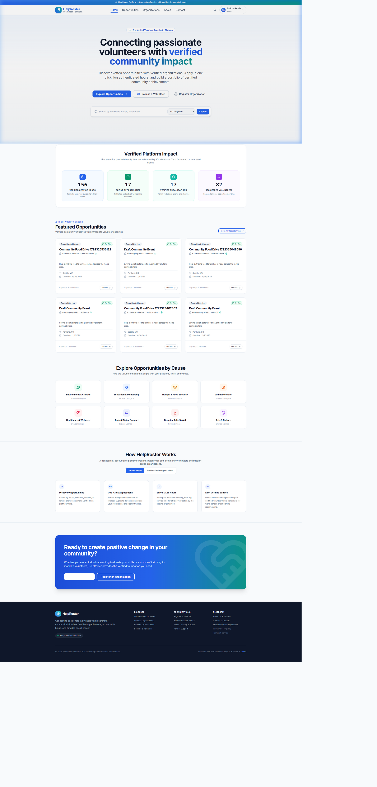
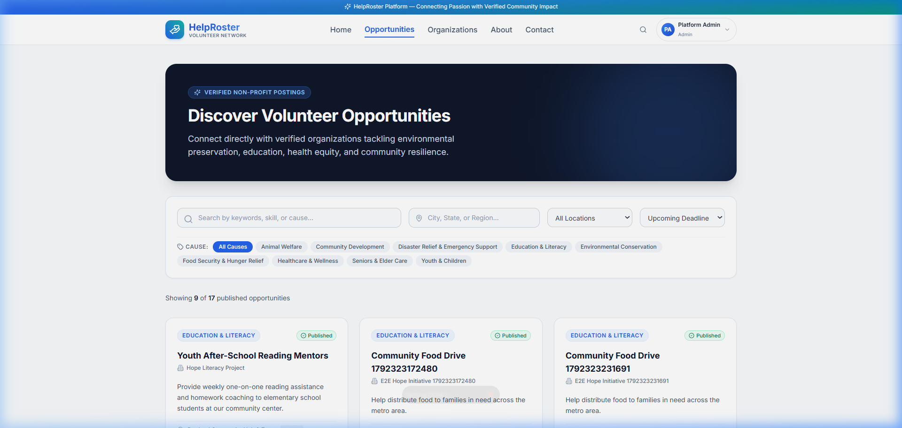
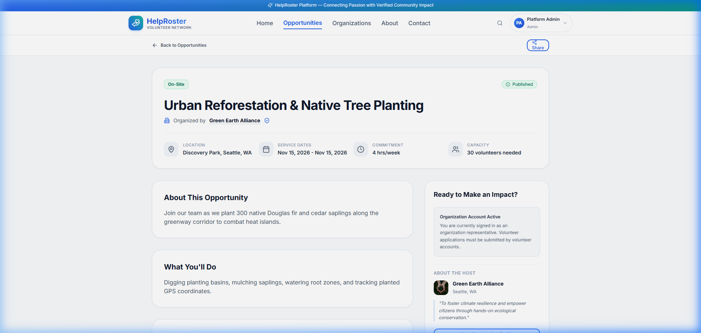
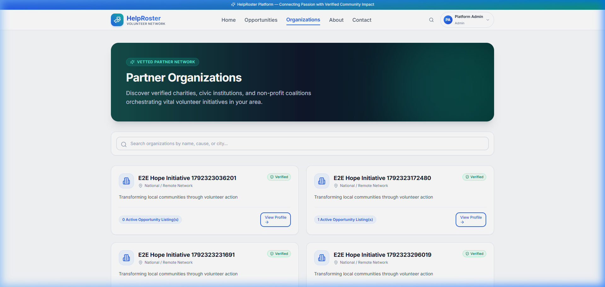
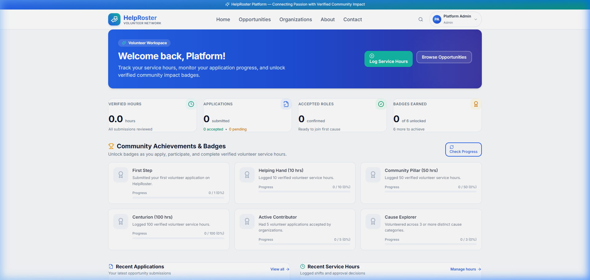
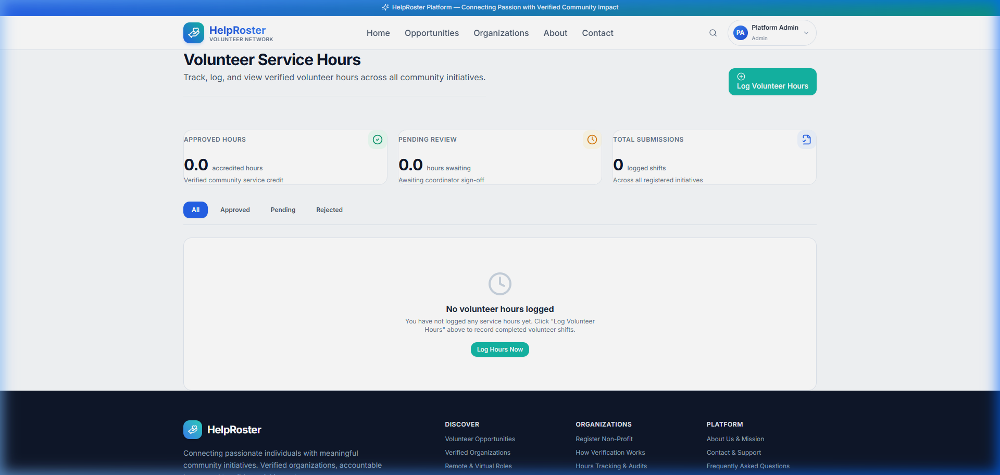
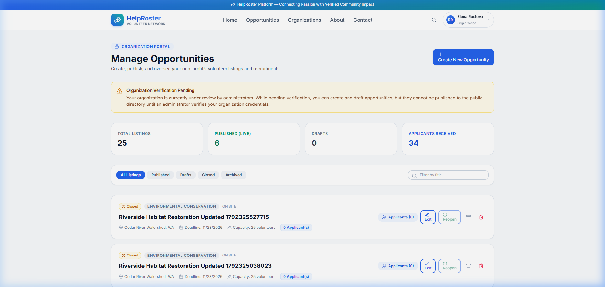
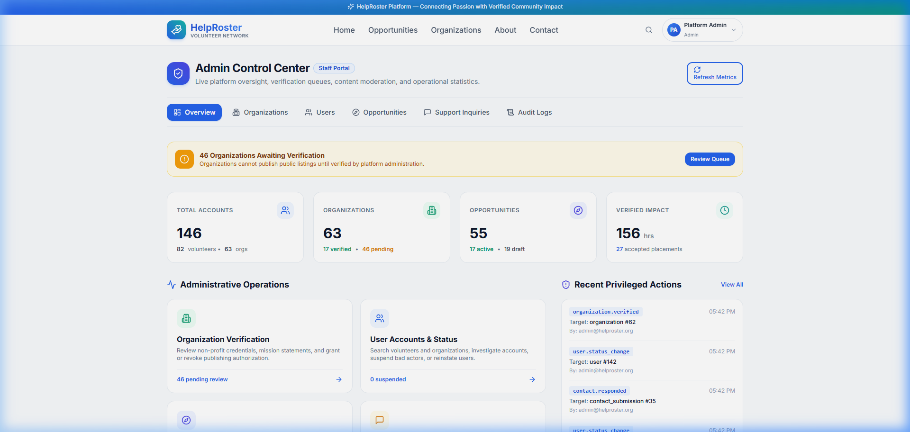

# <div align="center"> <br /> 🤝 HelpRoster <br /> <sub>Empowering Communities • Connecting Causes • Inspiring Action</sub> </div>

<div align="center">

[](https://nodejs.org)
[](https://react.dev)
[](https://vitejs.dev)
[](https://www.mysql.com)
[](https://tailwindcss.com)
[](https://www.docker.com)
[-10b981.svg?style=for-the-badge&logo=checkmarx&logoColor=white)](server/tests/runner.js)
[](LICENSE)

<br />

**[Key Features](#-platform-features-by-persona)** •
**[Visual Showcase](#-visual-showcase--screenshots)** •
**[Tech Stack & Architecture](#-system-architecture)** •
**[Quick Start](#-quick-start-local-development)** •
**[Demo Credentials](#-pre-seeded-demo-accounts--credentials)** •
**[Docker](#-production-deployment-with-docker)** •
**[Documentation](#-comprehensive-documentation)**

</div>

---

## 📖 Executive Summary

**HelpRoster** is a modern, enterprise-grade, full-stack volunteer management and opportunity discovery platform. Built to eliminate friction between passionate community members and mission-driven organizations, HelpRoster pairs **real-time opportunity search**, **one-click application workflows**, **verified service hour accreditation**, **gamified volunteer milestones**, and **administrative moderation** within an accessible, mobile-responsive web application.

---

## 📸 Visual Showcase & Screenshots

Experience HelpRoster through actual platform views captured across all three primary user roles:

### 🌟 1. Engaging Landing Page & Hero
> Modern, community-focused welcome portal featuring real-time impact metrics, mission highlights, and instant calls to action for both volunteers and non-profit coordinators.

<div align="center">
  
</div>

<br />

---

### 🔍 2. Opportunity Discovery & Exploration
> Fast, multi-faceted filtering by search query, cause category, location format (On-site, Remote, Hybrid), date ranges, and volunteer skills. Displays real-time spots remaining and registration deadlines.

<div align="center">
  
</div>

<br />

---

### 📋 3. Detailed Opportunity Overview & Instant Applications
> Comprehensive view detailing organization accreditation, schedule, required skills, logistics, safety guidelines, and one-click application submission with statements of interest.

<div align="center">
  
</div>

<br />

---

### 🏛️ 4. Verified Community Organizations Directory
> Public directory of verified non-profit partners, community initiatives, and philanthropic groups with direct links to active volunteer drives.

<div align="center">
  
</div>

<br />

---

### 📊 5. Volunteer Dashboard & Application Tracking
> Personalized command center displaying submitted applications, real-time approval status (`pending`, `accepted`, `declined`), upcoming commitments, and cumulative impact statistics.

<div align="center">
  
</div>

<br />

---

### 🏅 6. Verified Hours Accounting & Gamified Achievement Badges
> Volunteers record service hours paired with specific opportunities. Milestone achievements (*First Step*, *Active Contributor*, *Cause Explorer*, *Hours Club*) unlock automatically as impact grows.

<div align="center">
  
</div>

<br />

---

### 🏢 7. Organization Representative Workspace
> Empower coordinators to publish and modify listings, manage capacity limits, review volunteer applications with coordinator notes, and accredit logged hours with transparent audit trails.

<div align="center">
  
</div>

<br />

---

### 🛡️ 8. Platform Governance & Administrator Workspace
> Complete governance cockpit for platform administrators: verify incoming non-profits, audit or moderate user accounts, manage listings, triage support inquiries, and inspect immutable audit logs.

<div align="center">
  
</div>

<br />

---

## 💡 Platform Features by Persona

| Feature Domain | 🙋 Volunteers | 🏢 Organizations | 🛡️ Platform Admins |
|---|:---:|:---:|:---:|
| **Opportunity Search & Filters** | ✅ Full Discovery | ✅ Preview Own Listings | ✅ Global Search & Audit |
| **Direct Application Submission** | ✅ 1-Click with Statement | ❌ N/A | ❌ N/A |
| **Applicant Review & Decisions** | ❌ View Own Status | ✅ Accept / Decline / Notes | ✅ Full Oversight |
| **Opportunity Creation (CRUD)** | ❌ N/A | ✅ Draft / Publish / Close | ✅ Moderate / Archive |
| **Service Hours Logging** | ✅ Submit Log Entries | ❌ N/A | ❌ N/A |
| **Hours Review & Approval** | ❌ N/A | ✅ Approve / Reject Logs | ✅ View Audit Reports |
| **Gamified Milestones & Badges** | ✅ Automatic Unlocks | ❌ N/A | ❌ N/A |
| **Organization Vetting Gate** | ❌ N/A | ⚠️ Requires Admin Approval | ✅ Approve / Reject Orgs |
| **Account Moderation & Suspension**| ❌ N/A | ❌ N/A | ✅ Global Moderation |
| **Immutable Audit Logging** | ❌ N/A | ❌ N/A | ✅ Full Log Viewer |

---

## 🏗️ System Architecture

```
                                  ┌────────────────────────────────────────┐
                                  │            Browser Client              │
                                  │      React 18 + Vite + Tailwind CSS    │
                                  └───────────────────┬────────────────────┘
                                                      │
                                                      │ HTTPS / JSON REST
                                                      ▼
                                  ┌────────────────────────────────────────┐
                                  │          Nginx Reverse Proxy           │
                                  │          (Alpine / SSL / Gzip)         │
                                  └─────────┬────────────────────┬─────────┘
                                            │                    │
                        ┌───────────────────┘                    └───────────────────┐
                        │ /api/v1/*                                                  │ /* (Static SPA)
                        ▼                                                            ▼
         ┌──────────────────────────────┐                             ┌──────────────────────────────┐
         │     Node.js Express API      │                             │     Vite Production Build    │
         │   (Node 20 / Zod / Argon2)   │                             │      HTML / CSS / JS SPA     │
         └──────────────┬───────────────┘                             └──────────────────────────────┘
                        │
         ┌──────────────┴───────────────┐
         ▼                              ▼
┌──────────────────┐          ┌───────────────────┐
│   MySQL 8.0 DB   │          │  SMTP Mail Relay  │
│  InnoDB Pooling  │          │ (Ethereal / Prod) │
└──────────────────┘          └───────────────────┘
```

### Technology Highlights
- **Frontend Layer:** React 18, Vite 5, React Router v6, Tailwind CSS 3.4, Lucide Icons, Axios, Context API state management.
- **Backend API Layer:** Node.js 20 LTS, Express.js (`/api/v1` versioned endpoints), Zod request schema validation, Helmet security headers, CORS protection, Cookie-Parser, Morgan structured logging.
- **Data Persistence:** MySQL 8.0 with InnoDB engine, strict foreign key constraints, ACID transaction boundaries, and connection pooling via `mysql2/promise`.
- **Authentication & Security:** Argon2 / Bcrypt password hashing, `httpOnly` secure cookie JWT authentication, CSRF token mitigation, and IP-based rate limiting.
- **Testing Architecture:** Native Node.js test runner (`node --test`), 8 integration test suites, 118 automated tests passing at 100%.

---

## 📁 Repository Directory Structure

```text
HelpRoster-Volunteer-Opportunity-Platform/
├── client/                     # Frontend Application (React 18 + Vite + Tailwind)
│   ├── src/
│   │   ├── components/         # Reusable UI library (Cards, Modals, Forms, Badges)
│   │   ├── layouts/            # RootLayout, SiteHeader, SiteFooter
│   │   ├── pages/              # 16 role-tailored view pages
│   │   ├── routes/             # App routing and ProtectedRoute RBAC gates
│   │   ├── context/            # AuthContext (JWT session state)
│   │   └── services/           # Centralized API service clients
│   ├── Dockerfile              # Multi-stage production container build
│   └── nginx.conf              # Production Nginx reverse proxy configuration
├── server/                     # Backend REST API (Node.js 20 + Express)
│   ├── src/
│   │   ├── config/             # DB pool, environment variables, security
│   │   ├── controllers/        # REST route handler controllers
│   │   ├── middleware/         # Auth, RBAC, error handling, rate limiting
│   │   ├── routes/             # REST endpoint routers (/api/v1)
│   │   ├── schemas/            # Zod input validation schemas
│   │   ├── services/           # Business logic & transactional email
│   │   └── database/           # Automated migration, seed, and backup runners
│   ├── tests/                  # 8 integration test suites (118 automated tests)
│   └── Dockerfile              # Production Node 20 Alpine container
├── database/                   # Database schemas and standalone tooling
│   ├── schema.sql              # Clean DDL relational schema (11 tables)
│   ├── seeds.sql               # Production baseline seed data
│   ├── migrations/             # Versioned schema migrations
│   ├── backup.js               # Standalone database backup tool
│   └── restore.js              # Standalone database restore tool
├── Docs/                       # Comprehensive Engineering Specifications
│   ├── screenshots/            # High-resolution platform UI screenshots
│   ├── HelpRoster_PRD.md       # Product Requirements Document
│   ├── Architecture .md        # Architectural Design Document
│   ├── Design .md              # UI/UX Specifications and Design Tokens
│   ├── DEPLOYMENT.md           # Production Deployment & Operations Guide
│   ├── API_Reference.md        # Comprehensive REST API Reference
│   ├── Role-Based-Workflow.md  # Persona testing and user journeys
│   └── Task.md                 # Project backlog & implementation record
└── docker-compose.yml          # Multi-container production orchestration
```

---

## ⚡ Quick Start: Local Development

### Prerequisites
- **Node.js:** v18.0.0 or higher (v20+ recommended)
- **MySQL:** v8.0 or higher
- **npm:** v9.0.0 or higher

### 1. Configure Backend & Database
```bash
# Clone the repository
git clone https://github.com/your-org/HelpRoster.git
cd HelpRoster

# Setup server environment
cd server
cp .env.example .env
# Edit .env with your local MySQL credentials:
# DB_HOST=localhost, DB_USER=root, DB_PASSWORD=your_password, DB_NAME=helproster_db

# Run automated schema migrations and seed initial data
npm install
npm run db:migrate
npm run db:seed
```

### 2. Start the Backend API
```bash
# Run backend in development mode (hot reloading)
npm run dev
# Server listening on http://localhost:5000 (Health Check: http://localhost:5000/api/v1/health)
```

### 3. Start the Frontend Application
```bash
# Open a new terminal in client/
cd client
cp .env.example .env
npm install
npm run dev
# Frontend web app accessible at http://localhost:5173
```

---

## 🔑 Pre-Seeded Demo Accounts & Credentials

The automated database seed (`npm run db:seed`) provisions ready-to-use accounts for all three platform roles with identical test passwords (`Password123!`):

| Role | Persona / Organization | Email Address | Password | Primary Accessible Workspace |
|---|---|---|---|---|
| 🛡️ **Platform Admin** | Platform Administrator | `admin@helproster.org` | `Password123!` | `/admin` (Governance Portal) |
| 🏢 **Organization Rep** | Elena Rostova (Green Earth Alliance) | `contact@greenearth.org` | `Password123!` | `/manage/opportunities`, `/applicants` |
| 🏢 **Organization Rep** | Marcus Vance (Hope Literacy Project) | `director@hopereading.org` | `Password123!` | `/manage/opportunities`, `/applicants` |
| 🙋 **Volunteer (Primary)** | Jane Doe (Event Organizer) | `jane.doe@example.com` | `Password123!` | `/dashboard`, `/opportunities`, `/hours` |
| 🙋 **Volunteer (STEM)** | Alex Smith (Student Mentor) | `alex.smith@example.com` | `Password123!` | `/dashboard`, `/opportunities`, `/hours` |
| 🙋 **Volunteer (Healthcare)**| Sarah Jenkins (Community Nurse) | `sarah.jenkins@example.com`| `Password123!` | `/dashboard`, `/opportunities`, `/hours` |

> [!TIP]
> **Single-Click Demo Autofill:** The login screen at `http://localhost:5173/login` features a **"Quick Demo Accounts"** button row (**Volunteer**, **Organization**, **Admin**). Clicking any button instantly populates the email and password fields!

### 🛡️ 1. Platform Administrator Account
- **Email:** `admin@helproster.org`
- **Password:** `Password123!`
- **Role / Access Level:** `admin` (System Administrator)
- **Accessible Workspaces & Features:**
  - 🌐 **Executive Dashboard:** [`/admin`](http://localhost:5173/admin) — Real-time metrics across total users, organizations, opportunities, and hours.
  - 🏛️ **Organization Vetting:** [`/admin/organizations`](http://localhost:5173/admin/organizations) — Review, approve (`verified`), or reject non-profit registration requests.
  - 👥 **User Moderation:** [`/admin/users`](http://localhost:5173/admin/users) — Inspect user directory, toggle account suspension, audit roles.
  - 📋 **Opportunity Oversight:** [`/admin/opportunities`](http://localhost:5173/admin/opportunities) — Review and unpublish non-compliant listings with reason codes.
  - 📬 **Public Support Queue:** [`/admin/support`](http://localhost:5173/admin/support) — Review and resolve public contact inquiries (`new`, `in_progress`, `resolved`).
  - 📜 **Security Audit Trail:** [`/admin/audit-logs`](http://localhost:5173/admin/audit-logs) — Inspect immutable logs tracking actor, client IP, action, and target entity.

### 🏢 2. Community Organization Representative Accounts
- **Account A (Environmental Non-Profit):** `contact@greenearth.org` / `Password123!` (Green Earth Alliance, Seattle WA)
- **Account B (Literacy & Education Non-Profit):** `director@hopereading.org` / `Password123!` (Hope Literacy Project, Portland OR)
- **Role / Access Level:** `organization` (Verified Status)
- **Accessible Workspaces & Features:**
  - 📝 **Opportunity Management:** [`/manage/opportunities`](http://localhost:5173/manage/opportunities) — Draft, publish, edit, or close volunteer opportunities.
  - 📥 **Applicant Review Queue:** [`/applicants`](http://localhost:5173/applicants) — Review volunteer statements of interest; accept or decline with coordinator notes.
  - ⏱️ **Hours Accreditation:** [`/manage/hours`](http://localhost:5173/manage/hours) — Validate or reject volunteer hour logs with feedback notes.
  - 📊 **Organization Dashboard:** [`/dashboard`](http://localhost:5173/dashboard) — View listing metrics and volunteer engagement stats.

### 🙋 3. Community Volunteer Accounts
- **Account A (Active Contributor):** `jane.doe@example.com` / `Password123!` (Jane Doe — Community Outreach & Event Coordination)
- **Account B (STEM / Student):** `alex.smith@example.com` / `Password123!` (Alex Smith — Youth Tutoring & Coding Mentorship)
- **Account C (Healthcare / Nurse):** `sarah.jenkins@example.com` / `Password123!` (Sarah Jenkins — Health Clinics & First Aid)
- **Role / Access Level:** `volunteer` (Active Status)
- **Accessible Workspaces & Features:**
  - 🔍 **Opportunity Discovery:** [`/opportunities`](http://localhost:5173/opportunities) — Multi-criteria search, filters, and 1-click applications.
  - 📊 **Volunteer Dashboard:** [`/dashboard`](http://localhost:5173/dashboard) — View upcoming sessions, pending applications, and total verified hours.
  - 📁 **My Applications:** [`/my-applications`](http://localhost:5173/my-applications) — Monitor application review statuses (`pending`, `accepted`, `declined`) and withdraw submissions.
  - 🏅 **Hours & Achievements:** [`/hours`](http://localhost:5173/hours) — Log completed volunteer hours and view milestone badges (*First Step*, *Active Contributor*, *Hours Club*).
  - 👤 **Volunteer Profile:** [`/profile`](http://localhost:5173/profile) — Manage public bio, contact information, skills, and causes.

---

## 🐳 Production Deployment with Docker

Deploy the complete multi-container stack (MySQL 8, Express REST API, Nginx Static Frontend) with a single command:

```bash
# 1. Prepare environment variables
cp server/.env.production.example server/.env.production
cp client/.env.production.example client/.env.production

# 2. Build and launch all containers in detached mode
docker compose up -d --build

# 3. Check health and running status
docker compose ps
```

Once running:
- **Web Application:** `http://localhost` (Port 80 / 443)
- **REST API Healthcheck:** `http://localhost/api/v1/health`

---

## 🧪 Testing & Verification

HelpRoster maintains zero external testing runtime dependencies, leveraging the high-performance native Node.js test runner (`node:test`):

```bash
cd server
npm test
```

### Automated Test Matrix (118 Tests Passing at 100%)
- **`auth_and_profiles.test.js`**: Registration, Argon2 hashing, JWT cookies, profile updates, and privacy controls.
- **`opportunities.test.js`**: CRUD lifecycle, state transitions, organization verification gates, and keyword search.
- **`applications.test.js`**: Application submission, duplicate application defense, withdrawal flows, and review decisions.
- **`dashboards_and_hours.test.js`**: Service hour logging, coordinator approvals/rejections, and idempotent milestone unlocks.
- **`admin_and_email.test.js`**: Organization vetting, account suspensions, public support inquiries, and transactional email queuing.
- **`contact.test.js`**: Public inquiry validation, rate-limiting, and administrative resolution workflows.
- **`e2e_journey.test.js`**: Comprehensive multi-role pipeline from fresh user signup through service hour accreditation.
- **`security.test.js`**: SQL injection immunity, RBAC boundary enforcement, rate-limiting headers, and sanitized error disclosures.

---

## 💾 Database Management & Disaster Recovery

HelpRoster includes built-in standalone database utilities requiring no external binaries:

```bash
# Apply all incremental schema migrations
npm run db:migrate

# Populate demo data
npm run db:seed

# Reset and recreate development schema from scratch
npm run db:reset

# Create a clean, timestamped SQL backup in database/backups/
npm run db:backup

# Restore database from the latest SQL backup file
npm run db:restore
```

---

## 📚 Comprehensive Documentation

Explore our detailed engineering runbooks and design specifications:

- 🚀 **[Production Deployment & Operations Guide](Docs/DEPLOYMENT.md)** — VPS setup, Nginx reverse proxy, SSL with Certbot, backup scheduling, and monitoring.
- 📡 **[REST API Reference](Docs/API_Reference.md)** — Comprehensive documentation of all `/api/v1` endpoints, envelopes, status codes, and JSON payloads.
- 📝 **[Product Requirements Document (PRD)](Docs/HelpRoster_PRD.md)** — High-level functional specifications, user stories, and acceptance criteria.
- 📐 **[System Architecture](Docs/Architecture%20.md)** — Architectural diagrams, entity relationships, security posture, and data models.
- 🎨 **[UI/UX Design Specification](Docs/Design%20.md)** — Design tokens, color palette, responsive typography, and component specs.
- 👥 **[Role-Based Workflow Guide](Docs/Role-Based-Workflow.md)** — Step-by-step persona user journeys and verification guides.

---

## 📄 License

This project is licensed under the **MIT License** — see the [LICENSE](LICENSE) file for complete details.

<div align="center">
  <sub>Built with ❤️ for passionate volunteers and thriving community organizations.</sub>
</div>
